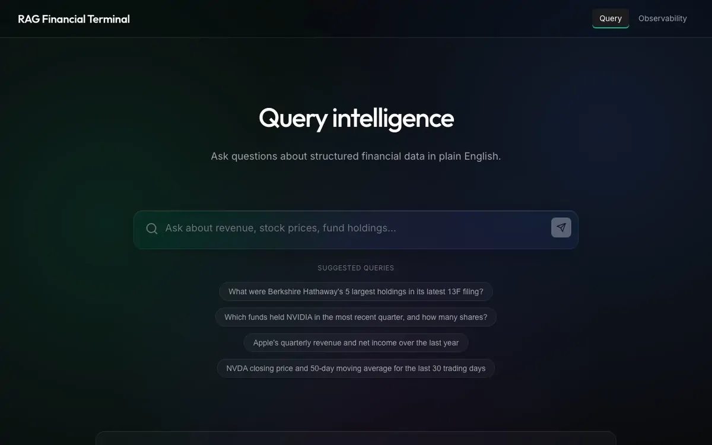

# RAG Data Platform

[](https://github.com/shreyescodes/RAG-Data-Platform/actions/workflows/ci.yml)
[](https://www.python.org/)
[](https://nodejs.org/)
[](LICENSE)

**Ask questions about real financial data in plain English. Get an answer, the
SQL behind it, the source rows and a fact check of every claim.**

[](#documentation)

[](https://drive.google.com/file/d/11FsdRm2k9En9UV5VRdxL8K_Y3wq5RsRx/view)

<sub>Recorded from a local Docker Compose run with real SEC and Yahoo Finance
data. Responses were not mocked or edited. Captions were added and the wait for
the LLM is shortened. The app is not hosted publicly.</sub>

## How it works

```text
"Which stocks did Berkshire Hathaway buy last quarter?"
        │
        ▼
 PII redaction ─► hybrid schema search ─► structured SQL generation ─► SQL validation ─► read-only execution
                  (FAISS + BM25,             (JSON schema, retries,      (sqlglot)              │
                   rank fusion)               exact/semantic cache)                             │
                                                                                                ▼
   fact check ◄─ answer + insights ◄─ analysis (LLM) ◄─ enrichment (Yahoo / SEC) ◄─ rows + citations
 (claims vs rows)                                  progress streamed to the browser at each step
```

## What I built

- **Hybrid retrieval:** embedding and BM25 keyword search, merged with
  Reciprocal Rank Fusion, to find the right tables for each question.
- **Reliable text-to-SQL:** schema-validated LLM output, with errors fed back
  on retry.
- **SQL safety in depth:** a `sqlglot` allow-list, read-only transactions,
  statement timeouts and row caps.
- **PII redaction:** emails, phone numbers, SSNs, card numbers and IP addresses
  are masked before a question reaches the LLM, logs or audit tables.
- **Hallucination detection:** each claim in an answer is checked against the
  returned rows by rule-based checks and an LLM judge, with evidence shown for
  every verdict.
- **Chat interface:** a React app with saved chats, follow-up questions, live
  progress for each step, charts, sources and the SQL behind every answer.
- **Ready for a public demo:** private history for each visitor, daily
  question limits, a clear message when the model's quota runs out, and no
  answers about how much data is stored.
- **Observability:** tokens, cost, latency per stage and failures for every
  request, on a built-in dashboard.
- **Tested end to end:** unit, integration and browser tests plus secret,
  dependency and container scans in CI, and a load test.
- **Deployment setup:** Docker Compose, automatic TLS and a deploy script that
  rolls back on failed health checks. Written, but not deployed yet.

## Results

| Measure | Result |
|---|---|
| Execution accuracy on 50 questions over the real data | **49/50** |
| Behaviour checks: refusals, live data, prompt injection, PII, cache | **6/6** |
| Planted hallucinations caught by the rule-based checks | **18/21**, with **0/28** false alarms |
| Questions where search found every table needed | **70/70** |
| Load test (stand-in LLM, one server process) | **80** concurrent users, 0 errors |
| Tests | **442** backend (97% coverage), **91** frontend, **10** browser |

Accuracy was measured on 19 November 2026 with Groq `openai/gpt-oss-120b`, by
running the generated SQL and comparing it with hand-written answers. The one
miss and every generated query are in [the report](docs/evaluation.md).
[See the full results](docs/results.md).

## Tech stack

| Layer | Tools |
|---|---|
| Backend | Python, FastAPI, Pydantic, SQLAlchemy, Alembic, sqlglot |
| Data | PostgreSQL 16, Yahoo Finance, SEC EDGAR |
| AI and retrieval | sentence-transformers, FAISS, BM25, any OpenAI-compatible LLM |
| Frontend | React 19, Vite, Vitest, Playwright |
| Ops | Docker, nginx, Caddy, GitHub Actions, gitleaks, pip-audit, Grype |

## Run it locally

You need Docker and an LLM API key. A free [Groq](https://console.groq.com) key
works.

```bash
cp .env.example .env   # set LLM_API_KEY, API_KEY and POSTGRES_PASSWORD
docker compose up -d --build
docker compose exec backend python -m app.cli seed   # about 10 minutes
```

Then open <http://localhost:8080>.

## Documentation

| Topic | What it covers |
|---|---|
| [Features and screenshots](docs/features.md) | Every feature, how it is verified, and screenshots |
| [Architecture](docs/architecture.md) | Pipeline, design decisions, scaling notes and [limitations](docs/architecture.md#limitations) |
| [Measured accuracy](docs/results.md) | Evaluation results and the defects they uncovered |
| [Evaluation reports](docs/evaluation.md) | Full runs: [accuracy](docs/evaluation.md), [retrieval](docs/evaluation-retrieval.md), [hallucination](docs/evaluation-hallucination.md), [load test](docs/load-test.md) |
| [Security](docs/security.md) | Threat model and controls |
| [Testing and quality](docs/quality.md) | Test suites and CI checks |
| [Getting started](docs/getting-started.md) | Setup, data, configuration and project layout |
| [API reference](docs/api.md) | Endpoints and response format |
| [Deployment](docs/deployment.md) | Hosting setup (not deployed yet), rollback, backups and monitoring |
| [Capabilities and tuning](docs/capabilities.md) | How to use and tune each major capability |
| [Contributing](CONTRIBUTING.md) | Workflow and conventions |

## License

[MIT](LICENSE)
