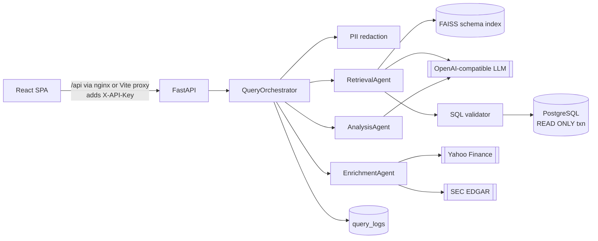

# Architecture

## System overview

The backend is a single FastAPI service. Long-lived resources are created once
in the application lifespan and held in a `ServiceContainer`
([`app/container.py`](../backend/app/container.py)):

- the embedding model (loaded and warmed up at startup)
- the FAISS index
- the LLM client
- a shared `httpx.AsyncClient`

Request-scoped objects (the database session, the agents and the orchestrator)
are assembled per request by FastAPI dependencies
([`app/api/dependencies.py`](../backend/app/api/dependencies.py)).

## Query pipeline

`QueryOrchestrator.run()` ([`app/agents/orchestrator.py`](../backend/app/agents/orchestrator.py)):

1. **Redact PII** from the raw question. Everything downstream (LLM prompts,
   logs, the audit row and the response) sees only the redacted text.
2. **Retrieval** ([`agents/retrieval.py`](../backend/app/agents/retrieval.py))
   1. Embed the question and search the schema index. Hits are aggregated per
      table (best score plus a small breadth bonus). Tables scoring below 75%
      of the best match are dropped, and the top `RETRIEVAL_MAX_TABLES` are
      kept.
   2. Expand along foreign keys and declared relations (for example,
      `market_data` joins to `companies` on ticker), so join paths are always
      present.
   3. Render the selected tables as annotated DDL and ask the LLM for one
      PostgreSQL query. The model may answer `CANNOT_ANSWER` when the schema
      does not cover the question.
   4. Validate and rewrite the SQL ([`rag/sql_validator.py`](../backend/app/rag/sql_validator.py)),
      then execute it read-only ([`db/readonly.py`](../backend/app/db/readonly.py)).
3. **Enrichment** ([`agents/enrichment.py`](../backend/app/agents/enrichment.py)).
   This step runs only when the question mentions prices, quotes or filings.
   Tickers are taken from result rows, from ticker symbols in the question,
   or from company names in the question. Quotes and filings are fetched
   concurrently. A failed lookup is recorded in the trace and does not fail
   the request.
4. **Analysis** ([`agents/analysis.py`](../backend/app/agents/analysis.py)).
   The LLM gets the question, the SQL, a bounded sample of rows and the
   enrichment data, and returns JSON that is validated with Pydantic. If the
   LLM fails or returns malformed output, a deterministic summary is used and
   the stage is marked `degraded`.
   **Live-data fallback.** If SQL generation reports `CANNOT_ANSWER` but the
   question asks for live market or filing data (for example "NVDA's market
   cap", which is not stored), retrieval is marked `skipped`, enrichment runs
   on its own, and the analysis answers from live data. If enrichment also
   finds nothing, the original "cannot be answered" error is returned.
5. **Audit.** The redacted query, SQL, a result sample, the trace, timing and
   outcome are written to `query_logs`. A failure to write the audit row is
   logged and never fails the request.

Each stage reports `completed`, `skipped`, `degraded` or `failed` in
`agent_flow`, and appends steps to a per-request `Trace` returned to the client.

### Error contract

Domain failures raise subclasses of `PlatformError`
([`core/exceptions.py`](../backend/app/core/exceptions.py)). Each carries a
`user_message` that is safe to show to clients; the exception's own text is
only logged. Examples are an unanswerable question, rejected SQL, an execution
error, or the LLM being unavailable or unconfigured.

The orchestrator turns these into `200 {"success": false, "error": ...}`,
because they are outcomes of a valid request. Anything unexpected reaches a
global handler that logs the stack trace with the request ID and returns a
generic `500`.

## Design decisions

**Schema catalog from ORM metadata rather than live introspection.** The
models are the source of truth that migrations are generated from, and they
carry natural-language descriptions (`info={"description": ...}`) without
affecting DDL. This makes indexing deterministic, testable without a database,
and gives the retriever far richer text than bare column names. Tables marked
`info={"queryable": False}` (the audit log) are never indexed or allowed in
generated SQL.

**Cosine similarity over normalised embeddings, exact search.** The schema
produces fewer than 100 documents, so `IndexFlatIP` is exact and fast. The
index is rebuilt rather than appended to, which keeps re-indexing idempotent.
Files are written atomically, and a manifest records the embedding model so a
model change triggers a re-index instead of silently returning wrong results.

**Local embeddings, hosted generation.** `all-MiniLM-L6-v2` runs in-process,
so schema text never leaves the server and retrieval has no per-query cost.
SQL generation and analysis use any OpenAI-compatible endpoint, selected by
configuration.

**The validator re-renders the SQL it approved.** sqlglot parses the
statement, the checks run on the syntax tree, and the executed SQL is the
tree rendered back with the enforced `LIMIT`. There is no string splicing, so
what runs is exactly what was validated.

**Async API, sync ORM.** The routes are async, and the blocking work
(SQLAlchemy calls, embedding, yfinance) is moved to the thread pool. This
keeps a single well-understood ORM path while not blocking the event loop.

## Data model

| Table | Description |
|-------|-------------|
| `companies` | Public and private companies; `ticker` is NULL for private ones |
| `financial_statements` | Quarterly and annual income statement, balance sheet and cash flow |
| `portfolio_companies` | PE investments: amount, valuation, ownership, stage, status |
| `performance_metrics` | Monthly ARR, MRR, customers, churn, CAC, LTV, burn, runway, multiples |
| `market_data` | Daily OHLCV with 50- and 200-day moving averages |
| `query_logs` | Audit trail (not queryable by the LLM) |

Schema changes go through Alembic. CI applies all migrations to PostgreSQL,
runs `alembic check` to prove the models and migrations agree, and tests the
downgrade path.

## Operations

- **Health:** `GET /api/health` returns 503 when the database is unreachable.
  Docker health checks use it.
- **Logging:** each request gets an `X-Request-ID` (accepted from the caller or
  generated) that appears in every log line and in the response headers.
  `LOG_JSON=true` emits one JSON object per line.
- **Startup:** the container entrypoint applies migrations, builds the schema
  index if it is missing, then starts uvicorn.

## Scaling notes

The current design targets a single instance. The natural next steps:

1. **Multiple replicas.** Move the vector index to a shared store
   (pgvector would keep everything in PostgreSQL) and move rate-limit counters
   to Redis (SlowAPI supports it).
2. **Latency.** Cache generated SQL by normalised question and schema version,
   and cache enrichment lookups for short TTLs.
3. **Larger schemas.** Index sample values and synonyms per column, and add a
   re-ranking step before SQL generation.
4. **Quality.** Build an evaluation set of question/SQL pairs and track
   execution accuracy in CI whenever prompts or models change.
