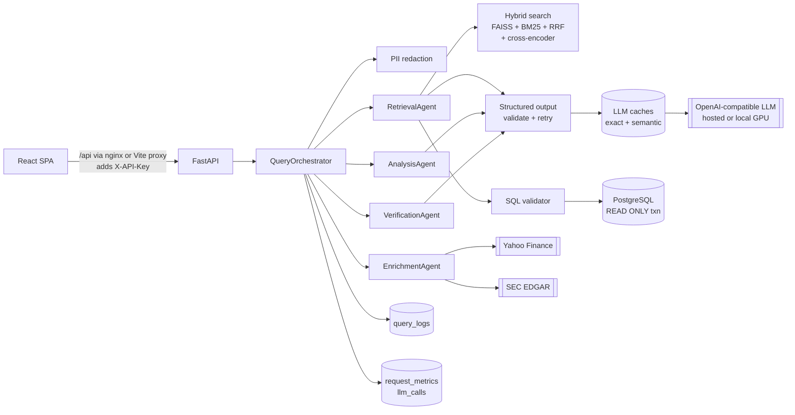

# Architecture

## System overview

The backend is a single FastAPI service. Long-lived resources are created once
in the application lifespan and held in a `ServiceContainer`
([`app/container.py`](../backend/app/container.py)):

- the embedding model and cross-encoder reranker (loaded and warmed up at startup)
- the FAISS index (the BM25 index is derived from it in memory)
- the LLM client, local or hosted
- the exact and semantic LLM caches
- a shared `httpx.AsyncClient`

Request-scoped objects (the database session, the agents and the orchestrator)
are assembled per request by FastAPI dependencies
([`app/api/dependencies.py`](../backend/app/api/dependencies.py)).

## Query pipeline

`QueryOrchestrator.run()` ([`app/agents/orchestrator.py`](../backend/app/agents/orchestrator.py)):

1. **Redact PII** from the raw question. Everything downstream (LLM prompts,
   logs, the audit row and the response) sees only the redacted text.
2. **Retrieval** ([`agents/retrieval.py`](../backend/app/agents/retrieval.py))
   1. **Hybrid schema search** ([`rag/schema_indexer.py`](../backend/app/rag/schema_indexer.py)).
      The question is matched against one document per table and per column by
      dense embeddings (FAISS, cosine) and by BM25 keywords
      ([`rag/sparse.py`](../backend/app/rag/sparse.py)); the two rankings are
      merged with Reciprocal Rank Fusion ([`rag/fusion.py`](../backend/app/rag/fusion.py)).
      A local cross-encoder ([`rag/reranker.py`](../backend/app/rag/reranker.py))
      rescores the fused shortlist. Document scores are aggregated per table,
      weak tables are dropped relative to the best, and the top
      `RETRIEVAL_MAX_TABLES` are kept. Every score (dense, sparse, fused,
      rerank) goes into the trace.
   2. Expand along foreign keys and declared relations (for example,
      `market_data` joins to `companies` on ticker), so join paths are always
      present.
   3. **Structured SQL generation** ([`rag/sql_generator.py`](../backend/app/rag/sql_generator.py)).
      The selected tables are rendered as annotated DDL. The model must reply
      with JSON (`answerable`, `sql`, `explanation`, `tables_used`,
      `confidence`). The reusable `StructuredOutputExtractor`
      ([`services/structured_output.py`](../backend/app/services/structured_output.py))
      validates each reply against the Pydantic model and against the SQL
      safety validator, and retries up to `LLM_STRUCTURED_MAX_ATTEMPTS` times
      with the errors fed back. `answerable: false` means the schema cannot
      answer.
   4. The validated, row-limited SQL ([`rag/sql_validator.py`](../backend/app/rag/sql_validator.py))
      runs read-only ([`db/readonly.py`](../backend/app/db/readonly.py)). If the
      database rejects it (unknown column, type error), the error is sent back
      for one corrected query (`SQL_REPAIR_ATTEMPTS`).
   5. **Citations** ([`rag/citations.py`](../backend/app/rag/citations.py)):
      sqlglot lineage maps each result column to its source `table.column`, and
      key columns identify the source row (or group) behind each result row.
3. **Enrichment** ([`agents/enrichment.py`](../backend/app/agents/enrichment.py)).
   This step runs only when the question mentions prices, quotes or filings.
   Tickers are taken from result rows, from ticker symbols in the question,
   or from company names in the question. Quotes and filings are fetched
   concurrently. A failed lookup is recorded in the trace and does not fail
   the request.
4. **Analysis** ([`agents/analysis.py`](../backend/app/agents/analysis.py)).
   The LLM gets the question, the SQL, a bounded sample of rows and the
   enrichment data, and returns JSON that is validated with Pydantic. If the
   LLM fails or returns malformed output, a deterministic summary is used and
   the stage is marked `degraded`.
   **Live-data fallback.** If SQL generation reports the question unanswerable but the
   question asks for live market or filing data (for example "NVDA's market
   cap", which is not stored), retrieval is marked `skipped`, enrichment runs
   on its own, and the analysis answers from live data. If enrichment also
   finds nothing, the original "cannot be answered" error is returned.
5. **Verification** ([`agents/verification.py`](../backend/app/agents/verification.py)).
   The answer is split into atomic claims. Every number, date, year and name
   in a claim is checked deterministically against the rows, column
   aggregates, the question and live data; a number attributed to an entity
   must come from that entity's row. Claims these checks cannot settle go to
   one structured LLM-judge call (`VERIFICATION_MODE=hybrid`). Each claim is
   reported as supported, partially supported, unsupported or not checkable,
   with links to its evidence.
6. **Audit and telemetry.** The redacted query, SQL, a result sample, the
   trace, timing and outcome are written to `query_logs`. Token usage, cost,
   cache hits and latency per stage go to `request_metrics` and `llm_calls`
   ([`observability/`](../backend/app/observability)). Neither write can fail
   the request.

Each stage reports `completed`, `skipped`, `degraded` or `failed` in
`agent_flow`, and appends steps to a per-request `Trace` returned to the client.

### Error contract

Domain failures raise subclasses of `PlatformError`
([`core/exceptions.py`](../backend/app/core/exceptions.py)). Each carries a
`user_message` that is safe to show to clients; the exception's own text is
only logged. Examples are an unanswerable question, rejected SQL, an execution
error, or the LLM being unavailable or unconfigured.

The orchestrator turns these into `200 {"success": false, "error": ...}`,
because they are outcomes of a valid request. Anything unexpected reaches a
global handler that logs the stack trace with the request ID and returns a
generic `500`.

## Design decisions

**Schema catalog from ORM metadata rather than live introspection.** The
models are the source of truth that migrations are generated from, and they
carry natural-language descriptions (`info={"description": ...}`) without
affecting DDL. This makes indexing deterministic, testable without a database,
and gives the retriever far richer text than bare column names. Tables marked
`info={"queryable": False}` (the audit log) are never indexed or allowed in
generated SQL.

**Cosine similarity over normalised embeddings, exact search.** The schema
produces fewer than 100 documents, so `IndexFlatIP` is exact and fast. The
index is rebuilt rather than appended to, which keeps re-indexing idempotent.
Files are written atomically, and a manifest records the embedding model so a
model change triggers a re-index instead of silently returning wrong results.

**Local embeddings, hosted generation.** `all-MiniLM-L6-v2` runs in-process,
so schema text never leaves the server and retrieval has no per-query cost.
SQL generation and analysis use any OpenAI-compatible endpoint, selected by
configuration.

**The validator re-renders the SQL it approved.** sqlglot parses the
statement, the checks run on the syntax tree, and the executed SQL is the
tree rendered back with the enforced `LIMIT`. There is no string splicing, so
what runs is exactly what was validated.

**Hybrid retrieval with every score kept.** Dense embeddings match meaning
("recurring revenue" to `arr`), BM25 matches exact identifiers (`ma_50`,
`runway_months`), and RRF merges them by rank, so neither score scale needs
calibrating. The cross-encoder is the most precise signal but the slowest, so
it only sees the fused shortlist. It is an enhancement, not a dependency: if
it fails to load, retrieval logs it, marks the result `degraded` and uses the
fused ranking. [`docs/evaluation-retrieval.md`](evaluation-retrieval.md)
measures each mode.

**Validation inside the retry loop.** The SQL safety validator is part of
the structured-output contract, so an unsafe or malformed reply is fed back
to the model with the reason. A model that keeps producing unsafe SQL still
ends in the same `UnsafeSQLError` as before.

**Deterministic checks before an LLM judge.** Numbers and names are checked
without a model, which is fast, free and cannot be talked out of a mismatch.
The judge only sees claims the checks cannot settle, and a deterministic
mismatch always wins over the judge.

**Telemetry through a context variable.** A per-request `RequestMetrics`
collector lives in a `ContextVar`. The LLM client, the agents and work run in
the thread pool all report into it without new parameters, and code outside
a tracked request reports nowhere.

**Async API, sync ORM.** The routes are async, and the blocking work
(SQLAlchemy calls, embedding, yfinance) is moved to the thread pool. This
keeps a single well-understood ORM path while not blocking the event loop.

## Data model

| Table | Description |
|-------|-------------|
| `companies` | 50 large US-listed companies: ticker, sector, industry, description (Yahoo Finance) |
| `financial_statements` | Quarterly and annual income statement, balance sheet and cash flow (Yahoo Finance) |
| `market_data` | Daily OHLCV with 50- and 200-day moving averages (Yahoo Finance) |
| `funds` | 13F filers: name and SEC CIK |
| `fund_holdings` | Quarter-end positions from SEC Form 13F: ticker, shares, value, portfolio weight, filing provenance |
| `security_identifiers` | CUSIP to ticker lookups from OpenFIGI, cached (not queryable) |
| `query_logs` | Audit trail (not queryable by the LLM) |
| `request_metrics` | Per-query outcome, tokens, cost, cache hits, latency by stage (not queryable) |
| `llm_calls` | Per-completion purpose, model, tokens, cost, latency, cache hit (not queryable) |

Schema changes go through Alembic. CI applies all migrations to PostgreSQL,
runs `alembic check` to prove the models and migrations agree, and tests the
downgrade path.

## Operations

- **Health:** `GET /api/health` returns 503 when the database is unreachable,
  and reports whether the LLM endpoint is local or remote. Docker health
  checks use it. `GET /api/health/llm` (API key) probes the LLM endpoint:
  reachable, latency, and whether the configured model is served.
- **Metrics:** `GET /api/metrics/summary`, `/timeseries` and `/recent` (API
  key) feed the Observability page: tokens, cost, latency percentiles per
  stage, error rate, failing and expensive queries, model usage.
- **Logging:** each request gets an `X-Request-ID` (accepted from the caller or
  generated) that appears in every log line and in the response headers.
  `LOG_JSON=true` emits one JSON object per line.
- **Startup:** the container entrypoint applies migrations, builds the schema
  index if it is missing, then starts uvicorn.

## Scaling notes

The current design targets a single instance. The natural next steps:

1. **Multiple replicas.** Move the vector index to a shared store
   (pgvector would keep everything in PostgreSQL), move rate-limit counters
   to Redis (SlowAPI supports it), and move the LLM caches to Redis so
   replicas share hits (they are per process today).
2. **Latency.** Cache enrichment lookups for short TTLs; serve the
   cross-encoder through ONNX Runtime, which is several times faster on CPU.
3. **Larger schemas.** Index sample values and synonyms per column.
4. **Telemetry at scale.** Aggregation runs in Python over the window's rows,
   which suits one deployment's traffic. Beyond that, roll up into a
   time-series store (Prometheus, TimescaleDB) and prune old rows.
